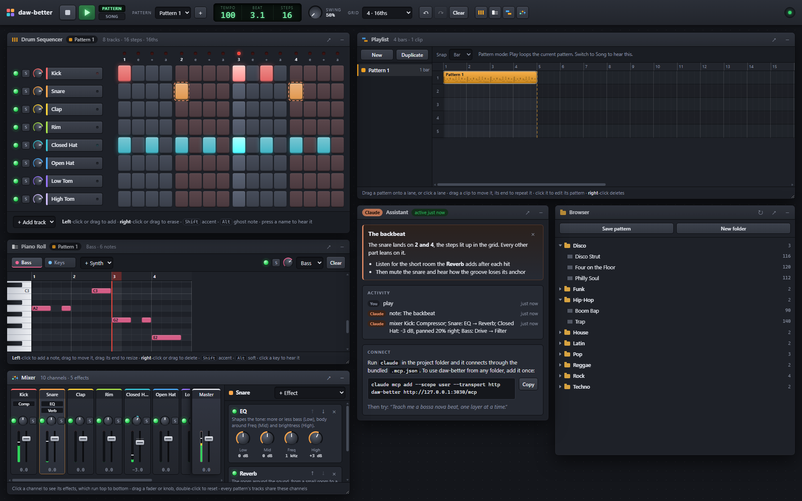

# daw-better

A self-hosted drum sequencer, piano roll, playlist and mixer for experimenting with music and teaching it, with Claude connected over MCP. You and Claude edit the same song: anything Claude writes appears on screen right away and is heard live while it plays, and Claude can read back what you changed by hand.

This is the start of a larger DAW project built around experimenting with music and learning it with AI.



Here Claude has set up the mixer (a compressor on the kick, EQ and reverb on the snare, drive and a filter on the bass) and left a note about the backbeat. The outlined snare steps are the ones the note is about.

## Quick start

```sh
npm install
npm start          # or: npm run dev  (restarts on server changes)
```

Open http://localhost:3030 and click once anywhere to turn on audio (browsers require a click before playing sound).

### Connect Claude

**Claude Code, in this folder:** run `claude`. The bundled [.mcp.json](.mcp.json) registers the server, and Claude Code asks you to approve it the first time. Check with `/mcp`.

**Claude Code, from any folder:**

```sh
claude mcp add --scope user --transport http daw-better http://127.0.0.1:3030/mcp
```

**Claude Desktop:** its config file launches local commands, so bridge to the HTTP endpoint with the community [`mcp-remote`](https://www.npmjs.com/package/mcp-remote) package:

```json
{
  "mcpServers": {
    "daw-better": { "command": "npx", "args": ["-y", "mcp-remote", "http://127.0.0.1:3030/mcp"] }
  }
}
```

The daw-better server has to be running for Claude to reach it. The Claude card in the app shows when Claude last connected.

Things to try:

- "Teach me a bossa nova beat, one layer at a time."
- "I just changed the hi-hats. What did that do to the feel?"
- "Make this swing like a J Dilla beat."
- "Quiz me: write a famous drum pattern and let me guess it."
- "Build up a funk groove with me and save each stage in a folder called Funk Lesson."
- "Write an intro, a verse and a chorus as separate patterns, then arrange them into a song."
- "Make the snare sound like an 80s snare."
- "Give the bass some grit, and tell me what to listen for."

## Using the sequencer

- Left-click a step to toggle it, or left-drag to paint steps on. Right-click erases a step, and right-drag erases everything it passes over. One drag is one undo step.
- <kbd>Shift</kbd>-click for an accent, <kbd>Alt</kbd>-click for a ghost note.
- Press a track's name button to hear its sound and show its channel in the Mixer. The green light mutes the track, **S** solos it, and the knob sets its volume (drag up or down, double-click to reset).
- <kbd>Space</kbd> plays and stops. <kbd>Ctrl</kbd>+<kbd>Z</kbd> undoes, <kbd>Ctrl</kbd>+<kbd>Shift</kbd>+<kbd>Z</kbd> redoes.
- **Tempo** and **Steps** in the display: drag up or down to change them, or click to type.
- **Grid** sets the subdivision: 16ths, 8ths, triplets, and so on. The counting row above the steps follows it ("1 e + a").
- **Swing** runs from 50% (straight) to 75%. 66% is a triplet shuffle.
- The sequencer, Piano Roll, Playlist, Mixer, Browser and Claude panels are windows. Drag them by the title bar, and double-click a title bar to collapse it. The four buttons after **Clear** in the toolbar bring the sequencer, Piano Roll, Playlist or Mixer to the front. Resize the Piano Roll, the Playlist and the Mixer from the bottom-right corner. This browser remembers where you put them. On narrow screens they stack.
- **↗** in a title bar pops that window out into a browser window of its own. Drag it to a second screen and make it as big as you like. **↙**, or closing that window, puts it back. Everything keeps working in a popped-out window: the meters, the playhead and the keyboard shortcuts. Reloading the page doesn't close popped-out windows, and closing the page closes them.
- The next time you pop a window out, it opens where you left it. On a second screen, Chrome and Edge first ask to let the page "manage windows on all your displays". Without that, the window opens on the main page's screen.

## Piano roll

Synth tracks play bass lines, melodies and chords. They share the drums' tempo, swing and step grid, so everything loops together.

- Each synth track has a tab. **+ Synth** adds one with a sound: Bass, Keys, Lead, Pad or Pluck. The green light mutes the selected track, **S** solos it, and the knob sets its volume.
- Left-click an empty spot to add a note, and drag a note to move it. Drag a note's right edge to change its length; new notes take the length you used last.
- Right-click deletes a note, and right-drag deletes every note it passes over.
- <kbd>Shift</kbd>-click a note to toggle an accent, <kbd>Alt</kbd>-click to toggle a soft note. Click a key on the keyboard to hear the pitch.
- The other synth tracks show faintly behind the selected one, so you can line parts up. When Claude writes notes, the roll switches to that track and the new notes flash.

## Patterns and the playlist

A song is made of patterns. Each pattern has its own drum and synth tracks, length, grid and swing, while the tempo belongs to the whole song. The sequencer and the Piano Roll always show the current pattern, and its name is in both title bars.

- Pick the current pattern from **Pattern** in the toolbar, or click it in the Playlist's pattern list. **+** (or **New** in the Playlist) makes an empty pattern with the same instruments, and **Duplicate** copies the current one, for a variation.
- In the pattern list, double-click a name or press <kbd>F2</kbd> to rename it. **Add** puts the pattern at the end of the song, and × or <kbd>Delete</kbd> deletes it along with its clips.
- **Pattern** / **Song** in the toolbar picks what Play does: loop the current pattern, or play the arrangement from bar 1 and start over at its end.

The Playlist lays the song out in bars, on up to 16 lanes:

- Drag a pattern from the list onto a lane, or click an empty spot to place the current pattern there.
- Drag a clip to move it, and drag its right edge to make it longer: a clip longer than its pattern repeats it. <kbd>Ctrl</kbd>-drag copies a clip. **Snap** switches between bars and beats.
- Click a clip to open its pattern in the sequencer and Piano Roll. Right-click deletes a clip, and right-drag deletes every clip it passes over.

The patterns and the arrangement are saved to `data/state.json` and restored when the server restarts. A save from before patterns existed loads as a single pattern placed at bar 1. Set `DATA_FILE` to save somewhere else, for example to run separate instances side by side with different `PORT`s.

## Mixer

The Mixer has a channel strip for every drum and synth track, and every channel then runs through **Master**. A channel belongs to the track, not the pattern: the Kick channel mixes the kick in every pattern that has it.

- The fader sets the level: 0 dB leaves it as it is, and all the way down is silent. Drag it (hold <kbd>Shift</kbd> for fine moves), scroll it, or use the arrow keys; double-click puts it back at 0 dB. The meter beside it shows the level after the fader and lights red at the top when the sound clips.
- The knob pans the sound left or right. The green light mutes the channel, and **S** solos it, so you hear only the soloed channels. These come after the track's own volume, mute and solo in the sequencer.
- Click a strip to see its effects on the right. **+ Effect** adds one, the light on its card turns it off and on (bypass), ↑ and ↓ move it, and × removes it. A channel holds up to 8.

Effects run top to bottom, and the order changes the sound: a drive before a reverb distorts only the dry sound, while after it the room gets distorted too.

| Effect     | What it does                                                                      | Try it for                                        |
| ---------- | --------------------------------------------------------------------------------- | ------------------------------------------------- |
| EQ         | More or less bass (Low), body around Freq (Mid) and brightness (High)              | Less mud, more snap on a snare, more air on hats  |
| Compressor | Turns down whatever goes over the Threshold, by the Ratio, so the level is more even. The Reduction bar shows how much | Punchier drums, a steadier bass |
| Drive      | Warm saturation, fuzz, or lo-fi bit crushing                                       | Grit on a bass, a crunchy beat                    |
| Filter     | Low-pass keeps what's below the Cutoff (darker), high-pass what's above (thinner), band-pass a band; Resonance adds a peak | A muffled or telephone sound, a thin intro |
| Delay      | Echoes in time with the tempo, in the middle or bouncing left and right (ping-pong) | Space on a lead, a dub snare                      |
| Reverb     | The room around the sound, from a small room to a huge hall                        | Distance and space                                |
| Chorus     | Slowly drifting copies that thicken and widen the sound                            | Wide keys and pads                                |

The mixer is saved with the song. Saving a pattern to the library keeps its notes and steps, but not the mixer.

## Loop library

The **Browser** window lists loops in folders. It comes with genre folders of ready-made grooves: Disco, Funk, Hip-Hop, House, Latin, Pop, Reggae, Rock and Techno. Click a loop to see its description and a preview of the pattern. Double-click it, press **Load into sequencer**, or drag it onto the sequencer to load it. Loading replaces the current pattern and sets the tempo, and <kbd>Ctrl</kbd>+<kbd>Z</kbd> brings the old one back. **Add as a new pattern** keeps the current pattern and adds the loop as another one, at the song's tempo; dragging a loop onto the Playlist does the same and places it where you drop it.

- **Save pattern** saves the current pattern's drums, piano-roll notes and swing, with the tempo, into a folder, with an optional description. If the pattern came from a library loop, that loop's name is filled in and the button says **Replace**; type a new name to keep both.
- **New folder** adds a folder, for a genre, a student or a lesson.
- Drag a loop up or down the list to reorder it, or onto another folder's name to move it there. <kbd>Alt</kbd>+<kbd>↑</kbd>/<kbd>↓</kbd> moves the selected loop from the keyboard.

Every open Browser window updates when the library changes, including when Claude saves a loop.

Loops are plain JSON files in [library/](library/), one folder each. You can also add one by hand: drop a file like this into a folder, then press ↻ in the Browser:

```json
{
  "name": "Four on the Floor",
  "description": "Kick on every beat, snare on 2 and 4, open hi-hat on the off-beats.",
  "bpm": 120,
  "swing": 50,
  "stepsPerBeat": 4,
  "length": 16,
  "tracks": {
    "kick": "x... x... x... x...",
    "snare": ".... x... .... x...",
    "open_hat": { "steps": "..x. ..x. ..x. ..x.", "volume": 0.6 }
  }
}
```

Track keys are instrument names, and the step strings use the same notation as Claude's tools (see below). To have two tracks with the same sound, give the track its own name and an `instrument` field: `"Ghost Snare": { "instrument": "snare", "steps": "..." }`.

Synth tracks go under `"synths"`, keyed by sound the same way, with notes in the notation Claude reads them in: `"synths": { "bass": "A2@1+2 C3@7+2 G2@9+2" }`. Loading a loop with synth tracks replaces the piano roll's tracks; a drums-only loop leaves them as they are.

Each folder's `.order.json` remembers the order its loops were arranged in, and loops missing from it are listed after the others, by name. Saved loops land in [library/](library/) next to the built-in ones, so they show up in `git status`. Set `LIBRARY_DIR` to keep the library somewhere else.

## What Claude can do

| Tool            | Purpose                                                            |
| --------------- | ------------------------------------------------------------------ |
| `get_state`     | Read the current pattern as text, the song's patterns and arrangement, and the user's recent edits |
| `list_loops` / `load_loop` | Browse the loop library and load a loop into the current pattern, or as a new one |
| `save_loop` / `move_loop` | Save the current pattern into a library folder, and put loops in order |
| `new_pattern` / `select_pattern` | Make a pattern (empty or a copy), and pick the one the editing tools change |
| `rename_pattern` / `delete_pattern` | Name a pattern after its song part, or delete it with its clips |
| `arrange`       | Place patterns in the Playlist by bar and lane, repeated to any length |
| `set_pattern`   | Write whole tracks from step strings (one undo step)               |
| `set_steps`     | Change individual steps                                            |
| `set_notes`     | Write notes and chords on a synth track (piano roll)               |
| `set_transport` | Tempo, swing, length, subdivision, pattern or song mode, play and stop |
| `set_track`     | Volume, mute, solo, name, sound (drum or synth track)              |
| `set_mixer`     | Mixer channels: fader, panning, mute, solo and the effect chain (one undo step) |
| `add_track` / `remove_track` / `clear` | Arrange drum and synth tracks               |
| `show_note`     | Show an explanation beside the grid and highlight steps            |
| `undo`          | Undo recent changes, by either of you                              |

Step strings use one character per step: `X` accent, `x` hit, `o` ghost note, `.` rest. Spaces and `|` are ignored, so `"x... x... x... x..."` is four-on-the-floor. A short string repeats to fill the pattern: `"x.."` over 16 steps gives a 3-against-4 polyrhythm.

Notes are given as a pitch name (`"C4"` is middle C, `"F#2"`, `"Bb3"`), a start step and a length in steps. Claude reads them back as `pitch@step+length`, so `A2@1+2` is an A2 on step 1 that lasts two steps.

## How it works

```
 Browser (UI + Web Audio synth)  ⇄  WebSocket  ⇄  Node server  ⇄  MCP (HTTP /mcp)  ⇄  Claude
```

- [server/store.js](server/store.js) holds the single source of truth, with undo history, the activity log and persistence.
- [server/operations.js](server/operations.js) contains every edit. The browser and Claude go through the same functions, so they can't drift apart.
- [server/library.js](server/library.js) reads and writes the loop library on disk. The Browser reaches it under `/api/library`, and Claude through the library tools.
- [server/mcp.js](server/mcp.js) defines the MCP tools and the instructions Claude receives when it connects. It runs in stateless Streamable HTTP mode.
- [shared/synths.js](shared/synths.js) lists the synth sounds and converts between note names and MIDI numbers, [shared/patterns.js](shared/patterns.js) holds the bar and pattern-length helpers, and [shared/mixer.js](shared/mixer.js) describes the effects and their settings, for both the server and the browser. Claude's `set_mixer` tool is built from the same list.
- [public/pianoroll.js](public/pianoroll.js) is the Piano Roll window, [public/playlist.js](public/playlist.js) the Playlist, [public/mixer.js](public/mixer.js) the Mixer, and [public/browser.js](public/browser.js) the Browser.
- [public/audio.js](public/audio.js) synthesizes every drum and synth sound, so there are no samples to load. A look-ahead scheduler plays the current pattern or the whole arrangement, keeps timing tight through tempo changes, and keeps playing in a background tab. Each track plays into its mixer channel.
- [public/effects.js](public/effects.js) builds the mixer on the Web Audio API: per channel, the effects in order, then pan, fader and meter, all into the master channel.
- [public/app.js](public/app.js) renders whatever state the server sends. Claude's edits briefly flash in the grid.
- [public/windows.js](public/windows.js) and [public/knob.js](public/knob.js) provide the draggable windows and rotary knobs. A popped-out window opens [public/popout.html](public/popout.html), and the main page moves the panel into it and keeps running it. So there is still one audio engine and one connection to the server. [public/views.js](public/views.js) lets the rest of the code work in every window: it looks elements up by id, adds listeners, and provides animation frames that keep coming while any window is on screen.

## Self-hosting on your network

By default the server listens only on `127.0.0.1`. To reach it from other devices, such as a tablet in a classroom:

```sh
HOST=0.0.0.0 ALLOWED_HOSTS=localhost,127.0.0.1,studio.local PORT=3030 npm start
```

In PowerShell: `$env:HOST="0.0.0.0"; $env:ALLOWED_HOSTS="localhost,127.0.0.1,studio.local"; npm start`

There is no authentication. Anyone who can reach the port can edit the song, write to the loop library and use the MCP endpoint, so only do this on a network you trust. `ALLOWED_HOSTS` lists the hostnames the server accepts, which protects against DNS rebinding and cross-site WebSocket connections.
